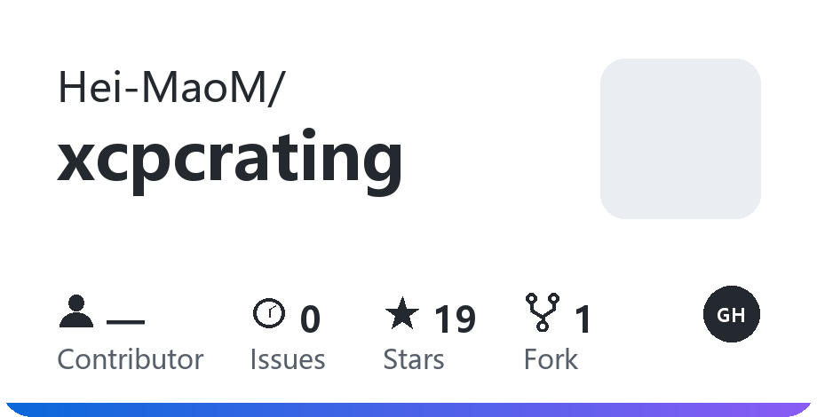

# astrbot_plugin_link_preview · 链接预览卡片

[](https://github.com/AstrBotDevs/AstrBot)


群里 **@机器人 发一条链接**，机器人把它「展开」成一张预览卡片图回在群里 —— 就像部分客户端的链接预览，
但由机器人出图，任何平台都能用。

## 效果预览

| GitHub 仓库 | B 站视频 | 通用网页 |
|---|---|---|
|  |  |  |

## 支持的链接

| 平台 | 链接形态 | 卡片内容 |
|---|---|---|
| **GitHub** | `github.com/{owner}/{repo}` | 仓库头像 + owner/repo + 贡献者 / Issues / Stars / Fork + 底部按头像取色的渐变条 |
| **B 站** | `/video/BVxxx`、`/video/avxxx`、`b23.tv` 短链 | 标题 + 封面大图 + UP主 / 点赞 / 投币 / 收藏 / 观看 + 原链接 |
| **通用网页** | 其他任意 `http(s)` 链接（github.io Pages、博客、文档站……） | 标题 + 封面 + 描述 + 站名 + 链接 |

不支持的内容（不是链接、是直链文件如 `.zip/.png/.pdf`）**完全不理** —— 不回复、不拦消息，交给 LLM 和其他插件。

## 安装

**方式一：上传 zip**（推荐）
在 AstrBot WebUI → 插件市场 → 「安装插件」→ 上传本仓库 Releases 里的 `astrbot_plugin_link_preview.zip`。

**方式二：克隆到插件目录**
```bash
cd /path/to/astrbot/data/plugins
git clone https://github.com/BW-YuChen/astrbot_plugin_link_preview.git
```
然后在 WebUI 里重载插件。

依赖只有 `Pillow`（AstrBot 本体通常已自带），卡片图离线渲染，**不需要浏览器**。

## 使用

```
@机器人 https://github.com/AstrBotDevs/AstrBot
@机器人 https://www.bilibili.com/video/BV1okeB6oEUx
@机器人 https://b23.tv/xxxxxxx
@机器人 https://zzzzzzyt.github.io/xcpc-elo
```

不需要任何斜杠指令：消息里带链接就行，一条消息多条链接只取第一条。

**`/链接诊断`** —— 逐项自检（配置 / 缓存 / 数据目录 / b23.tv / B 站接口 / GitHub API / GitHub 网页），
排障时先发它。这条指令都没回音，就说明插件没装上或没加载。

## 配置

| 配置项 | 默认 | 说明 |
|---|---|---|
| `enable_github` | `true` | GitHub 仓库链接预览开关 |
| `enable_bilibili` | `true` | B 站视频链接预览开关 |
| `enable_generic` | `true` | 通用网页卡片开关（关掉后未识别的链接回到「完全不理」） |
| `cooldown_seconds` | `5` | 同一用户两次解析的最小间隔，防刷 |
| `card_ttl_hours` | `12` | 卡片图磁盘保留时长，过期自动删 |
| `cache_minutes` | `10` | 接口结果缓存时长（1 分钟 ~ 1 天）；贡献者数按同比例放大，默认 6 小时 |
| `cache_max_mb` | `256` | 插件缓存目录上限，超限按最久未使用淘汰 |
| `cleanup_minutes` | `30` | 后台清理间隔（最短 5 分钟） |
| `silent_on_error` | `false` | 失败时是否静默（默认回一条简短原因，便于排障） |

## 缓存治理

卡片图是「用完即弃」的中间产物，插件自带两套清理规则，**不占服务器空间**：

- **12 小时过期**：`cards/` 下每张卡片图超时自动删除；
- **256 MB 上限**：整个缓存目录超限时按「最久未使用」淘汰到 90% 以内；
- **绝不误伤当前任务**：正在生成 / 发送中的卡片图显式登记为「使用中」，10 分钟内新写入的文件一律跳过；
- 头像 / 封面这类可复用素材**不按 12 小时清**（重复下载更费流量），只在触发体积上限时参与淘汰。

## 设计说明

**只取元数据，绝不下载视频**：B 站只取视频信息与一张封面缩略图，不碰播放地址与视频分片；
GitHub 只取仓库信息与一张头像。磁盘与带宽开销都极小。

**B 站风控的三层对策**（412 Precondition Failed 是这里的常客）：

1. **UA 档位轮试** —— 自己的对照实验结论：**浏览器型 UA + 非浏览器请求环境会被判定为伪造并稳定 412**，
   而朴素 UA（`curl/8.0` 之类，甚至自报家门的自定义 UA）反而放行。
   所以**先试朴素 UA**，Chrome UA 只作最后兜底，并把成功的档位记下来复用；
2. **buvid cookie** —— 从官方指纹接口领取，领不到就生成一个格式合法的；
3. **网页兜底** —— 接口仍被风控时直接抓视频网页，从页面内嵌数据取标题与真实的播放 / 点赞 / 投币 / 收藏。

**GitHub 兜底**：匿名接口每小时只有 60 次（共享机房 IP 常被打满），被限额或不通时自动抓仓库页面抠
Stars / Forks，与接口数据实测一致。

**字体**：优先 **思源黑体 / Noto Sans CJK SC** 等标准开源黑体，其次微软雅黑、苹方，老字体（文泉驿 / Droid）仅作兜底；
出图前会校验字体是否真的含中文字形，完全找不到就回退文本 —— 不给用户看一张豆腐块图。

## 目录结构

```
main.py            消息入口 + 限流 + 发送兜底 + 后台清理任务
core/fetch.py      链接识别（parse_target）+ GitHub / B 站 / 通用网页抓取 + 内存缓存 + 诊断探针
core/card.py       Pillow 卡片渲染（GitHub 卡 / B 站卡 / 通用网页卡）+ 字体挑选
core/cache.py      缓存治理（12 小时过期 + 256MB LRU 上限）
tests/             离线渲染 / 折行 / 缓存治理测试
```

## 测试

```bash
python tests/test_render_local.py            # 链接解析 + 折行 + 占位渲染
python tests/test_render_local.py --online   # 追加真实抓取渲染
python tests/test_cache.py                   # 缓存过期 / 上限 / 保护集
```

## 已知限制

- GitHub 网页兜底模式下 **Issues 显示 `—`**（该数字在当前页面首屏数据里没有，前端异步渲染）；
- 通用网页卡片依赖目标站点的 `og:` 标签，没有 og 标签的老站点只能出「标题 + 链接」的极简卡；
- B 站接口在部分机房 IP 上会长期处于风控状态，此时卡片走网页兜底，数据字段略少但功能正常。

## 更新日志

### v1.0.1

- **日志统一走 AstrBot**：卡片模块不再使用 Python 内置 `logging`，改为 `from astrbot.api import logger`，日志并入 AstrBot 的日志系统（级别 / 落盘 / WebUI 查看一致）。
- **`cache_minutes` 配置项生效**：此前是预留项，现在真正控制接口结果缓存时长（1 分钟 ~ 1 天），贡献者数按同比例放大。
- **数据目录不再多套一层**：直接使用 AstrBot 提供的插件专属目录，兼容返回共享根目录的旧版本。

### v1.0.0

首个版本：GitHub 仓库卡片、B 站视频卡片、通用网页卡片；12 小时卡片过期 + 256 MB 上限自动清理。

## License

[MIT](LICENSE)

## 致谢

- [AstrBot](https://github.com/AstrBotDevs/AstrBot) —— 插件运行框架
- [Pillow](https://python-pillow.org/) —— 卡片渲染
